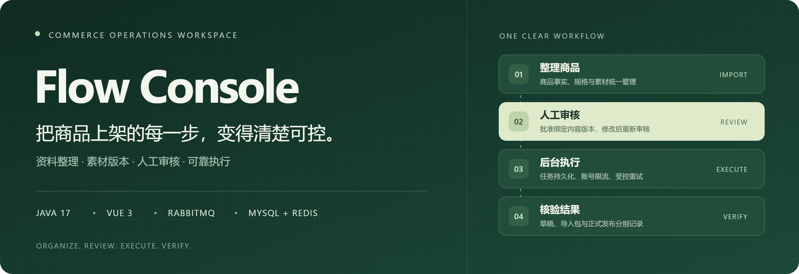
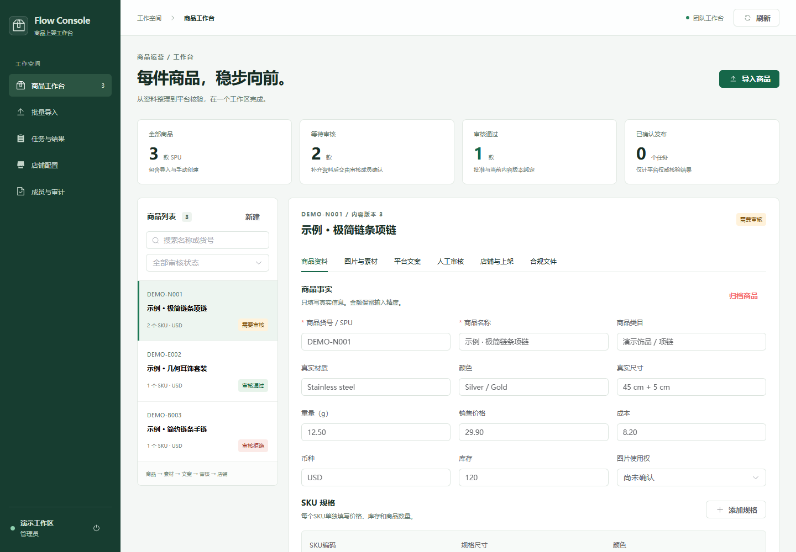
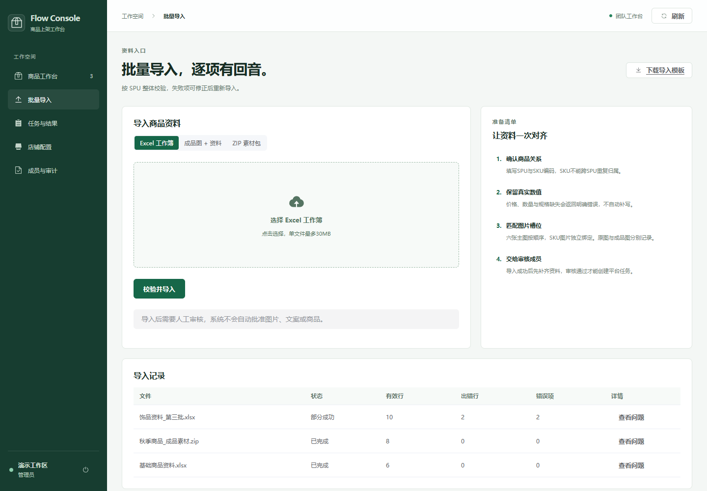
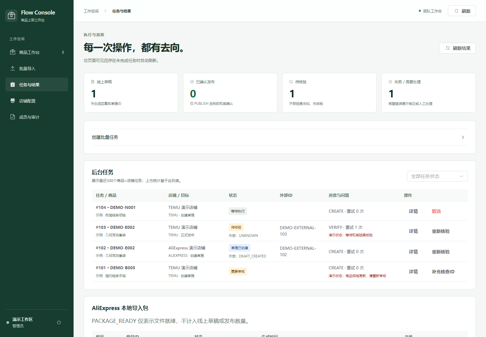
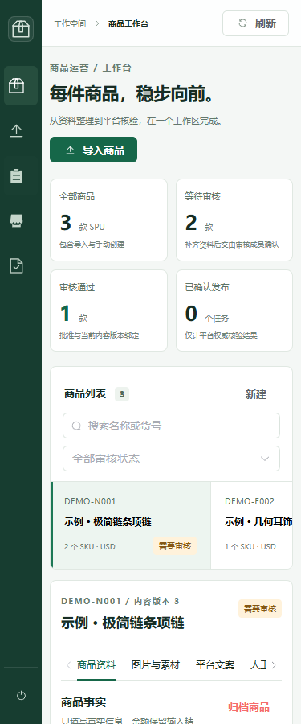
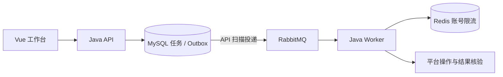

<p align="center">
  
</p>

<h1 align="center">商品上架的每一步，都有据可查。</h1>

<p align="center">
  面向商品运营团队的 <strong>Java / Vue 工作台</strong><br />
  把资料、素材、文案、审核与发布任务，放进一条清晰可追溯的工作流。
</p>

<p align="center">
  <a href="https://github.com/17elr/flow-console/actions/workflows/java-vue.yml"></a>
  <a href="server/pom.xml"></a>
  <a href="server/pom.xml"></a>
  <a href="web/package.json"></a>
  <a href="docker-compose.yml"></a>
</p>

<p align="center">
  <a href="#quick-start"><strong>快速开始</strong></a> ·
  <a href="#preview">界面预览</a> ·
  <a href="#architecture">架构设计</a> ·
  <a href="docs/README.md">文档中心</a>
</p>

---

<a id="workflow"></a>

## 从整理商品，到核验结果

Flow Console 服务于需要批量整理商品、协作审核素材、跟踪平台操作的运营场景。商品资料和审核版本始终与任务关联，出现问题时可以定位到具体商品、店铺、阶段和外部结果。

| 阶段 | 处理内容 |
| --- | --- |
| **01 · 整理** | 导入 Excel、文件夹与 ZIP，校验 SPU / SKU 关系和真实数值。 |
| **02 · 审核** | 检查素材、英文文案和关键字段，批准绑定当前内容版本。 |
| **03 · 执行** | 创建持久化后台任务，按平台账号共享限流，记录每次尝试。 |
| **04 · 核验** | 分别查看本地包、线上草稿、待核验和已确认发布。 |

<a id="preview"></a>

## 一个工作区，看清商品全流程

商品列表与详情并排，资料、素材、文案、审核和店铺按业务顺序组织。错误留在当前表单，修改后的资料需要重新审核。

<p align="center">
  <a href="docs/images/showcase-workbench.png"></a>
</p>

<details>
<summary><strong>查看更多界面：批量导入、任务控制台与移动端</strong></summary>

| 导入与逐项校验 | 任务与结果追踪 |
| --- | --- |
| [](docs/images/showcase-import.png) | [](docs/images/showcase-tasks.png) |
| 文件导入、问题清单与历史批次集中查看。 | 目标动作、执行阶段和真实外部状态分别呈现。 |

<p align="center">
  <a href="docs/images/showcase-mobile.png"></a>
</p>

</details>

<sub>以上为当前 Vue 页面配合合成演示数据的截图，仅展示界面；不代表真实店铺发布结果。查看[图片来源与复现方式](docs/images/SOURCES.md)。</sub>

## 能力一览

| 运营工作台 | 可靠执行与协作 |
| --- | --- |
| **商品与规格**：SPU、SKU、套装组件、精确金额与库存。 | **版本审核**：修改关键内容后，旧批准失效。 |
| **批量导入**：按 SPU 整体处理，区分出错行与错误项。 | **持久化任务**：MySQL 任务表与 Outbox 同事务保存。 |
| **素材管理**：原始字节、成品图、六图顺序、SKU 独立绑定及版本哈希。 | **受控重试**：重复消息防重、租约恢复、未知结果先核验。 |
| **文案与合规**：事实模板、人工编辑、文件提取、材料与包装复用。 | **角色分工**：运营整理资料、审核成员批准、管理员维护店铺。 |
| **平台入口**：TEMU 分阶段发布；AliExpress 独立草稿与本地包。 | **过程留痕**：操作者、版本快照、尝试记录与平台响应可追溯。 |

<a id="architecture"></a>

## 可靠性，落实在流程里

- **先保存，再执行**：任务与 Outbox 在同一 MySQL 事务中写入；消息确认且未被退回后才标记投递完成。
- **先审核，再发布**：批准绑定内容版本和稳定指纹；worker 使用不可变快照，发送前再次检查。
- **结果未知，先核验**：外部请求超时或本地提交失败后进入核验，不用盲目重建商品代替恢复。



API 与 worker 复用同一构建产物，以独立 profile 运行。普通成品图流程直接由 Java 完成；OCR / BiRefNet 可通过内部 Python 适配器接入。[查看完整架构与状态图 →](docs/ARCHITECTURE.md)

<details>
<summary><strong>展开技术栈与代码入口</strong></summary>

| 层次 | 技术 | 入口 |
| --- | --- | --- |
| 业务 API | Java 17 · Spring Boot 3.5.16 · Spring MVC · MyBatis 3.0.5 | [server/](server/) |
| 工作台 | Vue 3 · Vite · Element Plus · JavaScript · 原生 fetch | [web/](web/) |
| 存储与任务 | MySQL 8 · RabbitMQ · Redis · MySQL Outbox | [任务实现](server/src/main/java/com/flowconsole/task/) |
| 平台 HTTP | JDK HttpClient · 超时控制 · 脱敏证据 | [平台适配](server/src/main/java/com/flowconsole/platform/) |
| 认证 | HttpSession · CSRF · 数据库角色 · BCrypt | [认证实现](server/src/main/java/com/flowconsole/auth/) |
| 图像与文档 | Java ImageIO · Apache POI · PDFBox；可选 Python 算法 | [素材实现](server/src/main/java/com/flowconsole/asset/) |
| 验证与交付 | JUnit 5 · MockMvc · Playwright · Docker Compose · GitHub Actions | [CI 工作流](.github/workflows/java-vue.yml) |

依赖版本见 [Maven 配置](server/pom.xml)与[前端锁文件](web/package-lock.json)。

</details>

<a id="quick-start"></a>

## 三步启动

**准备 Docker 与 Docker Compose v2。**

**1. 获取项目**

```bash
git clone https://github.com/17elr/flow-console.git
cd flow-console
```

**2. 准备独立配置**

```bash
# Linux / macOS
cp .env.example .env.java
```

Windows PowerShell 使用 `Copy-Item .env.example .env.java`。编辑 `.env.java`，分别设置数据库、Redis、RabbitMQ 和初始管理员密码。

**3. 构建并启动**

```bash
docker compose --env-file .env.java up -d --build
```

打开 **[http://127.0.0.1:3000](http://127.0.0.1:3000)**，以 `admin` 和配置中的 `BOOTSTRAP_ADMIN_PASSWORD` 登录，再创建运营与审核成员。

停止服务并保留数据卷：

```bash
docker compose --env-file .env.java stop
```

Windows 也可使用根目录的 `安装环境.cmd` 与 `启动系统.cmd`。原生 Java / Node 开发、Linux 部署、HTTPS 和排错，见[运行手册](docs/RUNBOOK.md)。

## 有实现，也有验证

最近一次验收记录（2026-10-24）：**27 项 Java 检查、14 项浏览器场景**，并通过 Vue 构建和容器构建。Java 集成检查使用独立 MySQL、Redis、RabbitMQ 与本地 HTTP 假平台。

| 验证关注点 | 证据入口 |
| --- | --- |
| 并发请求防重、消息确认、外部结果丢失与旧 owner 写回 | [Java 测试](server/src/test/java/com/flowconsole/) |
| 登录、导入、审核、失败反馈、草稿归属与响应式布局 | [浏览器测试](web/e2e/) · [UI复查](docs/UI-REVIEW.md) |
| 旧 SQLite、金额、素材哈希和历史外部ID的迁移与回退 | [迁移指南](docs/MIGRATION.md) · [验收记录](docs/VERIFICATION.md) |
| 当前默认分支是否通过完整构建 | [GitHub Actions](https://github.com/17elr/flow-console/actions/workflows/java-vue.yml) |

本地检查：

```bash
mvn -B -f server/pom.xml verify
cd web
npm ci
npm test
npm run build
```

完整集成检查需设置 `RUN_INTEGRATION=true` 与独立 `flow_test_*` 数据库；浏览器测试需要对应测试 API 和合成数据。详见[运行手册中的检查命令](docs/RUNBOOK.md#检查命令)。

## 文档，从你的目标出发

| 我想… | 去这里 |
| --- | --- |
| 运行工作台 / 解决启动问题 | [快速开始](#quick-start) · [运行手册](docs/RUNBOOK.md) |
| 了解架构 / 对照接口与字段 | [架构设计](docs/ARCHITECTURE.md) · [Java API](docs/API-JAVA.md) · [数据字典](docs/DATA-DICTIONARY.md) |
| 阅读关键实现 / 找到测试依据 | [实现与测试索引](docs/INTERVIEW.md) |
| 迁移旧数据 / 查看兼容关系 | [迁移与回退](docs/MIGRATION.md) · [API 对照](docs/migration/API-MAP.md) |
| 查看所有文档 | **[进入文档中心 →](docs/README.md)** |

<details>
<summary><strong>版本、平台与模型的实际边界</strong></summary>

- 当前默认版本为2026-10-24开始的 Java / Vue 后续个人改造。原 FastAPI / Next.js 实现保留在 `apps/`，历史说明见 [LEGACY.md](docs/LEGACY.md)。
- 真实平台操作和收费图像模型默认关闭，启用前需要授权并核对实际契约。HTTP 假平台测试不等于真实店铺验收。
- AliExpress 不自动发布；本地 `PACKAGE_READY` 仅代表文件就绪，独立在线草稿入口缺少契约时返回409。
- 文案采用事实模板与人工编辑。可选OCR / BiRefNet缺少模型时明确报告不可用；图像模型只保存实际返回的产物。
- 数据库、素材、密钥、模型和本地备份不进入Git。迁移只复制与校验数据，保留原数据和回退入口。
- 本仓库尚未声明开源许可证。

</details>

---

<p align="center">
  <strong>Flow Console</strong><br />
  <sub>把商品整理好，把每次操作记录清楚。</sub>
</p>
