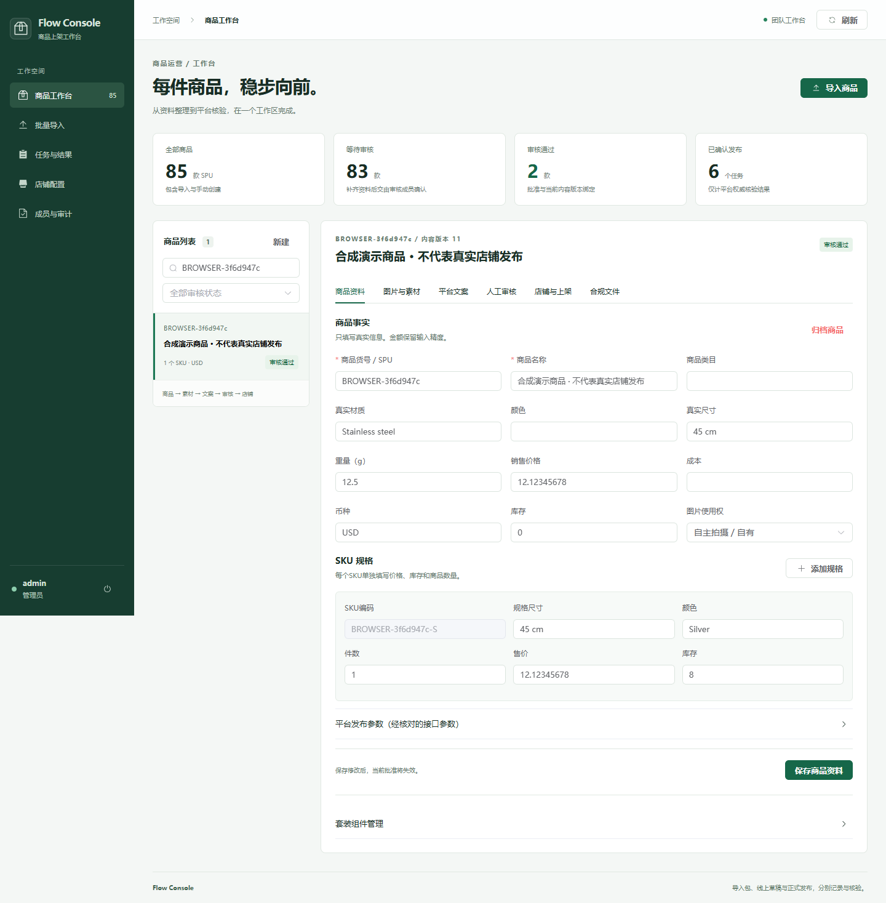

# Flow Console

面向商品运营团队的上架工作台：资料导入、素材版本、英文文案、人工审核、后台任务与平台结果核验。

**当前默认版本：Java / Vue 个人改造版（2026-10-24）。** 原 FastAPI / Next.js 版本保留在 `apps/`，作为历史实现和回退依据。改造不会追溯改变原项目的技术架构或历史工作量。



> 截图使用独立测试库中的合成商品及 HTTP 假平台，不代表真实店铺发布、生产吞吐或效率数据。

## 技术栈

| 部分 | 实际实现 |
|---|---|
| 核心业务 | Java 17、Spring Boot 3.5.16、Spring MVC、MyBatis 3.0.5、MySQL 8.0 |
| 工作台 | Vue 3、Vite、Element Plus、JavaScript、原生 fetch |
| 后台任务 | 同一 Java 产物的独立 worker、Spring AMQP、RabbitMQ、MySQL Outbox |
| 账号限流 | Redis 原子 Lua，按实际平台 AppKey 共享配额 |
| HTTP / 图片 | JDK HttpClient、Java ImageIO；可选 Python 算法适配器 |
| 认证 | HttpSession、CSRF、数据库角色校验、BCrypt 密码哈希 |
| 交付 | Maven、Docker Compose、GitHub Actions、JUnit / MockMvc / Playwright |

依赖锁定在 `server/pom.xml` 与 `web/package-lock.json`。没有引入 JPA、Celery、Nacos、Seata 或 Kubernetes。

## 主要能力

- Excel、成品图文件夹和 ZIP 导入；按 SPU 整体事务，返回出错行与错误项，重复导入复用业务编码。
- 商品、SKU、套装组件、六张主图和独立 SKU 图；保留素材来源、版本、哈希及原上传字节。
- Java 裁剪、缩放和真实尺寸图；Java 组织图像模型请求，可选内部 Python OCR / BiRefNet 组件。
- 商品事实模板与人工编辑英文文案；人工审核绑定内容版本及稳定指纹，换图或修改关键资料后重审。
- 异步任务唯一约束、持久化 Outbox、RabbitMQ 确认与手动 ACK、租约恢复、受控重试和账号共享限流。
- TEMU 分阶段建稿、认领、库存保存、发布和权威状态核验；AliExpress 独立在线草稿契约及本地导入包。
- 成员角色、店铺配置、合规文件、包装素材、每日计划、任务进度与操作审计。
- SQLite 只读导出、独立 MySQL 导入、原 ID 映射、金额核对、素材哈希与历史外部结果保留。

导入不会自动批准。`PACKAGE_READY`、`DRAFT_CREATED`、`VERIFYING` 和已确认发布分别显示。未知外部结果先核验，不能用“强制重试”重复创建商品。

## 启动

准备 Docker Compose v2，将 `.env.example` 复制为 **`.env.java`** 并设置独立强密码。无需覆盖旧 `.env`。

```bash
docker compose --env-file .env.java up -d --build
```

Windows 也可运行 `安装环境.cmd`、`启动系统.cmd`。工作台位于 [127.0.0.1:3000](http://127.0.0.1:3000)，初始账号 `admin`，密码来自 `BOOTSTRAP_ADMIN_PASSWORD`。管理员再创建运营与审核成员。

MySQL `13316`、Redis `16376`、RabbitMQ `15676` / 管理 `15677` 仅映射本机。停止使用 `docker compose --env-file .env.java stop`，保留数据卷。

原生 Java / Node 开发、Linux 部署、HTTPS、启动排错见 [运行手册](docs/RUNBOOK.md)。

## 验证

```bash
mvn -B -f server/pom.xml verify
cd web && npm ci && npm test && npm run build
```

完整集成检查还需独立 MySQL / Redis / RabbitMQ，设置 `RUN_INTEGRATION=true`；测试只接受 `flow_test_*` 数据库。浏览器验收在集成测试准备的合成数据上运行。完整命令、实际结果和限制见 [验收记录](docs/VERIFICATION.md)。

## 边界

真实平台和收费图像模型默认关闭。启用前必须获得真实店铺或模型调用授权，并填写经核对的类目、属性、包装、SKU 与公开素材参数。HTTP 假平台测试不等于真实平台验收。

AliExpress 不自动发布；没有完整在线契约时返回 409。普通成品图流程不依赖 Python。可选算法缺模型时明确不可用，不冒充 Java 已重写算法。文案目前是事实模板与人工编辑，未声明使用文本大模型。

## 文档

- [架构与状态图](docs/ARCHITECTURE.md) · [API](docs/API-JAVA.md) · [数据字典](docs/DATA-DICTIONARY.md)
- [迁移、校验与回退](docs/MIGRATION.md) · [逐项接口对照](docs/migration/API-MAP.md)
- [界面设计](docs/DESIGN.md) · [实现与测试索引](docs/INTERVIEW.md)
- [历史版本与原证据](docs/LEGACY.md)

数据库、素材、模型、密钥、迁移原始数据和本地备份均不进入 Git。仓库未声明开源许可证。
