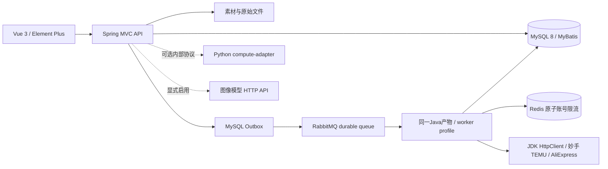
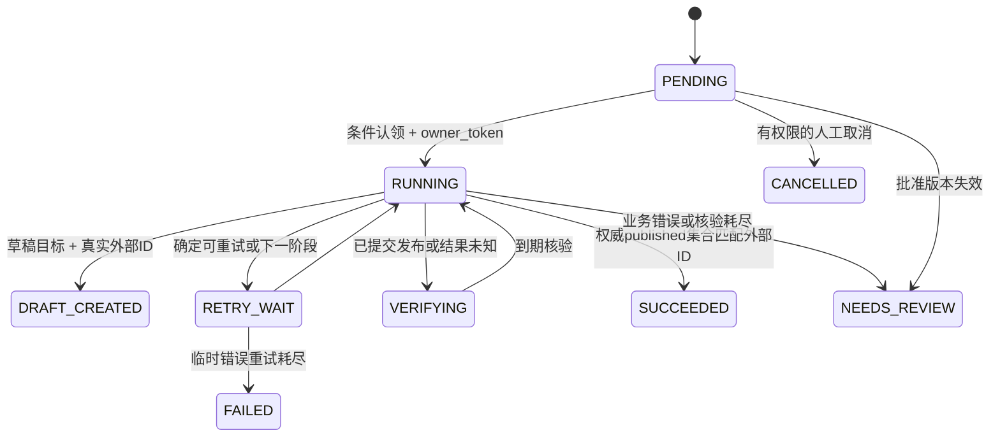

# Java / Vue 架构

改造日期：2026-10-24；原仓库基线：`3bc056c375391cdabfd6002246aa3f2485a742ff`。旧版FastAPI/React仍保留于`apps/`用于比对和回退，不是新业务的反向代理实现。

API承担商品/SPU/SKU/组件、Apache POI导入、素材与合规、确定性文案、版本审核、任务创建、Outbox投递和定时计划。worker仅消费与恢复任务，无公网HTTP入口；两种profile同时启用会失败。没有JPA或额外微服务注册中心。

审核保存`content_version`与稳定SHA-256指纹。商品、SKU、素材、文案、店铺配置的发布相关内容发生变化后，旧批准失效。任务保存完整不可变payload快照。尚未开始外部操作的旧版本任务转`NEEDS_REVIEW`；认领与发送前再次检查。已开始的任务只使用原快照完成阶段或核验，新版本不能与未知结果并发发布。

一个商品×店铺×批准版本×目标动作具有MySQL唯一约束；客户端请求键另外保存在`publish_request`，防止同key异参数。新建任务与Outbox事件处于同一事务。创建草稿后再请求同版本发布会复用已知草稿ID，不另建草稿。

TEMU阶段分别持久化CREATE、CLAIM、CLAIM_VERIFY、SAVE_STOCK、PUBLISH、VERIFY。HTTP成功不等于发布成功。外部写请求发起前持久化标志；崩溃或超时后进入核验，不盲目重建。`owner_token`和租约条件阻止旧worker覆盖新结果。

RabbitMQ消息仅含eventId/taskId/approvedVersion。Outbox使用投递租约、持久化消息、publisher confirm与mandatory return；缺任一成功条件均不标记SENT。消费结果先提交数据库后手动ACK。忙任务消息直接ACK，30秒数据库补偿负责恢复，避免立即requeue循环。

Redis Lua使用Redis服务器时间，为同一实际AppKey分配下一允许请求时间；不同接口、不同worker共享配额。等待发生在事务之外。Redis故障暂停发送。该机制不是外部恰好执行一次的证明。

普通成品图流程不需要Python。Java提供解码、裁剪、缩放、尺寸图；可选Python组件只接收图片和白名单参数，不能访问业务库。Java组织图像模型HTTP请求并保存实际素材与请求证据，缺配置、缺模型或仅返回任意URL时不会伪造产物。
