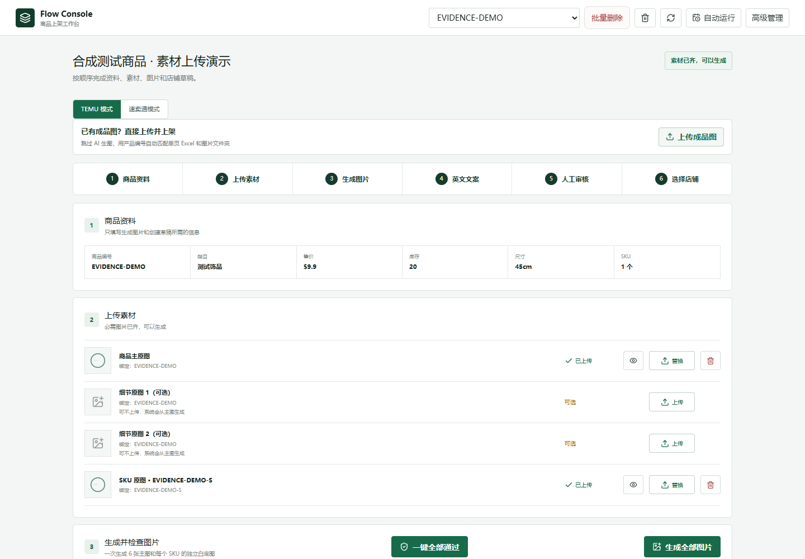

# Flow Console 本地真实运行记录

记录时间：2026-10-12T15:18:12.993761+08:00（UTC+08:00）。应用源码基线：`97ed2c04e6f30ec3e7c5e8396a7c6f10ab5360de`。

## 运行环境与方法

Windows、Python 3.12.5、临时 SQLite 文件与本地素材目录。使用 FastAPI TestClient 实际调用应用路由、SQLAlchemy 持久化与图片文件校验；没有模拟业务服务、数据库或文件存储。API 记录不启动网络服务器、应用生命周期和后台工作线程。

输入是脚本生成的 **25 个合成 SPU、50 个 SKU**，及 640×640 合成 PNG，用于技术验收，不是商户真实经营数据。

## 实测结果

| 验证项 | 实测 |
| --- | --- |
| Excel 导入 | 25 SPU / 50 SKU，COMPLETED，0 异常行 |
| 同一工作簿再次导入 | 仍为 25 SPU / 50 SKU，没有增加重复记录 |
| 新增素材演示商品 | 最终 26 SPU / 51 SKU |
| 商品主图与 SKU 原图上传 | 2 个真实文件写入临时素材目录，并可从 API 重新读取 |
| 伪图片上传 | HTTP 422，先前有效素材未被替换 |
| API 检查 | 13 项通过 |
| 本机本轮总耗时 | 570.99 ms，仅描述该次运行，不代表吞吐或人工效率 |
| 外部模型 / 店铺 API | 0 次 |

逐请求状态、耗时、输入哈希、环境和结果见 [demo-run.json](evidence/demo-run.json)。

## 复现

```powershell
python -m pip install -r apps/api/requirements.txt
python scripts/demo_evidence.py
```

脚本每次创建独立临时数据库与素材目录，使用断言检查结果，失败返回非零退出码，结束关闭数据库并清理临时目录；重新运行会更新机器可读报告。默认业务库与店铺不参与此流程。

## 真实浏览器截图与回归

另行运行 production Next.js build 与 Uvicorn（lifespan off），连接独立演示 SQLite，使用真实 Edge 1440×1000 捕获工作台，实际加载 `EVIDENCE-DEMO` 合成测试商品与本地上传 PNG；不修改浏览器 DOM 或伪造后端响应。[浏览器检查结果](evidence/browser-check.json)记录 JS 错误和溢出情况。



[完整工作台截图](images/workbench-full.png) · [截图来源](images/SOURCES.md)。

本次 API 回归 **56 项通过**；前端 ESLint、TypeScript 和 Next.js production build 均通过。测试使用仓库内独立临时目录；这是测试环境验收，不代表真实店铺发布成功、付费模型质量、生产负载或业务效率提升。
